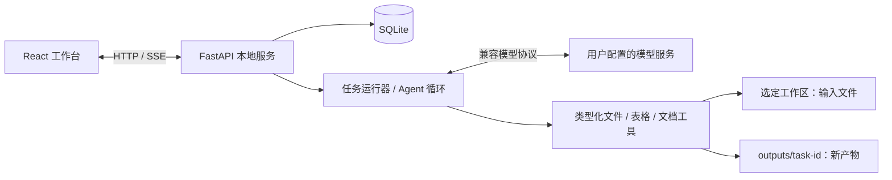

# 本地文件、数据与文档工作台：首版设计

日期：2026-10-12。项目目录：`D:\llm\agent\local-workbench`。状态：2026-10-12 已进入后端脚手架实施阶段；本设计描述首版目标，实际完成范围见[开发总文档](../../development/master-plan.md)。

## 1. 已确认目标与设计假设

用户希望参考 WorkBuddy 的逆向分析，独立实现自己的工作台；首版优先处理本地文件、数据和文档，并明确指定在上述目录开发。

本设计采用以下默认值：Windows 本机、单用户、中文界面、一次执行一个任务；先通过本机浏览器使用。模型服务由用户在设置中选择，不绑定 WorkBuddy 账号、内部 CLI 或腾讯私有接口。原始文件保持不变，生成文件保存到工作区的 `outputs` 子目录。

成功标准：用户选择工作目录后，可以浏览文件、提出自然语言任务、查看工具执行进度和结果，生成实际可打开的 Excel、Word、Markdown 或 PNG 文件；关闭并重启服务后，任务历史和产物记录仍可查看。

## 2. 技术路线选择

| 路线 | 取舍 |
|---|---|
| **React + FastAPI + Python 工具 + SQLite（推荐）** | Python 直接处理表格与文档；用本机浏览器快速完成业务闭环。当前机器已有 Python 3.13.9、Node 24.13.1 和主要 Python 库。 |
| Electron + React + Python | 增加原生目录选择、桌面窗口和安装包；需要额外处理 Electron/Python 生命周期与打包。适合第二阶段。 |
| Electron + React + TypeScript 工具 | 工作区、IPC 与工具可以统一类型；需要选择另一套文件处理库，且第一阶段就承担桌面分发成本。 |

推荐第一条。产品构建使用独立 Python 虚拟环境和项目依赖；不会因全局已安装库而省略依赖声明。

- 前端：React、TypeScript、Vite；普通 CSS；中文工作台界面。
- 后端：FastAPI、Uvicorn、HTTPX；HTTP API + SSE 事件流。
- 数据工具：Pandas、openpyxl；图表使用 Matplotlib。
- 文档工具：python-docx、pypdf；TXT/Markdown 使用标准库。
- 持久化：Python 标准库 sqlite3，启用外键与 WAL。
- 模型：OpenAI-compatible Chat Completions/tool calling 适配器；远端或本地服务均需满足该协议。
- 测试：pytest；前端构建/类型检查和关键用户流程验证。

参考官方能力说明：[FastAPI 文件处理](https://fastapi.tiangolo.com/tutorial/request-files/)、[FastAPI 流式响应](https://fastapi.tiangolo.com/advanced/stream-data/)、[Vite 启动要求](https://vite.dev/guide/)。具体依赖版本在实现计划与锁文件中确定。

## 3. 首版功能边界

### 3.1 工作区和文件

- 用户在设置中输入现有工作目录的绝对路径，后端验证它是可访问的目录。
- 首次启动默认使用项目的自建 `samples` 示例目录；不会自动读取其他个人目录。
- 界面显示文件树、文件类型、大小与更新时间；支持刷新和按名称过滤。
- 只在用户选择的工作区内读取文件。模型与工具使用后端登记的 `fileId`，不直接传任意系统路径。
- 工具只接受本任务明确选中的 fileId，或本任务生成的 resultId；不能通过猜测 ID 读取其他任务的文件/结果。
- 支持 CSV、XLSX、TXT、Markdown、DOCX 和文本型 PDF。
- 表格预览显示列、类型、行数和最多 100 行数据；XLSX 可选择 worksheet。
- 文档预览提供可提取文本和来源定位。扫描 PDF 无文本时明确提示当前版本未提供 OCR。
- 单文件默认上限 50 MiB；单表上限 100,000 行、200 列；超限返回明确错误。

### 3.2 数据处理

通过受控参数实现：概览、缺失值统计、筛选、排序、去重、选择列、分组聚合和简单图表。

筛选由列名、操作符和值组成；聚合允许 count、sum、mean、min、max。列和操作符必须经过 schema 校验。首版不执行模型生成的 Python、Shell、SQL 或 Pandas eval 表达式。

模型可把自然语言任务转换为这些工具的调用；工具负责计算，模型负责解释已有结果。结果表和图表保留输入文件、worksheet、参数和输入哈希。

### 3.3 文档整理

- 提取选中文档的正文片段，带 `sourceId` 和页码、段落号或字符范围。
- 模型生成摘要、对比或结构化报告，引用必须指向本次任务已读取的来源。
- 结构化报告包含标题、摘要、章节、表格和来源引用。
- 输出 DOCX 或 Markdown；数据表输出 XLSX；图表输出 PNG。
- 不包含 Word 原位编辑、复杂 PDF 排版、OCR、浏览器采集、企业 IM、插件商店或桌面鼠标操作。

### 3.4 任务和产物

- 创建、执行、取消、查看和重试任务。
- 展示用户消息、助手文本、工具名称、输入摘要、运行状态、错误及产物卡片。
- 查看历史任务、预览产物、下载文件和查看输出路径。
- 为每次任务分配独立输出目录；采用唯一文件名，避免覆盖已有文件。
- 未配置模型时，文件浏览、预览和手动生成数据概览可使用；自然语言任务给出配置提示。
- 不把测试模型或静态示例输出伪装成真实模型结果。

## 4. 界面与典型流程

三栏工作台：左侧是工作区文件和任务历史，中间是任务输入与执行记录，右侧是文件/表格/图表/文档产物预览。顶部显示当前工作区、模型连接状态和设置入口。

### 数据任务

```text
设置工作目录 → 选择 CSV/XLSX → 输入“按月份汇总销售额并生成图表”
→ 读取结构 → 校验和执行聚合 → 生成表格与图表
→ 展示结果说明 → 下载 XLSX/PNG
```

### 文档任务

```text
选择 PDF/DOCX/Markdown → 输入整理要求 → 提取带定位的文本
→ 模型生成带引用的结构化报告 → 校验引用
→ 生成 DOCX/Markdown → 预览和下载
```

文件是上下文数据，用户输入决定任务。文档正文中的指令不会被当作新增工具授权。

## 5. 架构及组件边界



### 前端

负责输入、文件选择、状态和预览。只通过后端 API 操作工作区；后端不回传已配置密钥，用户在设置中输入的密钥提交后清空前端输入。SSE 断开后从最后事件序号恢复，并过滤重复事件。

### API 与工作区服务

校验路径、登记文件身份、提供预览与下载、保存配置及任务记录。默认只绑定 `127.0.0.1`；校验本地请求的 Host/Origin，开发时仅允许明确的本机前端地址。文件下载只能使用登记过的产物 ID。

### 任务运行器

管理队列、任务状态、事件序号、取消标记和产物提交。首版只有一个活动任务，其余排队。进程重启不自动重放模型请求，未完成任务标记为 interrupted，允许用户重试。

### 模型适配器和 Agent 循环

读取 endpoint、model、运行时密钥；请求模型并解析流式文本和工具调用。工具调用必须是注册工具并通过 schema 校验。默认最多 12 轮，单次模型请求超时 120 秒；超时或达到上限都产生明确的终止状态。

上下文包含文件结构、选定数据样本、需要的文档片段和已执行工具摘要，不自动上传整个工作区。默认数据样本最多 20 行，文档片段每次最多 12,000 字符；界面显示当前任务引用的文件。

密钥只在服务进程内存中使用；设置页面保存 endpoint/model，密钥不写入 SQLite、不出现在日志或响应中。重启后需重新输入，或通过 `WORKBENCH_API_KEY` 环境变量配置。

### 工具和导出

每个工具有独立输入/输出 schema、错误码、来源信息和取消检查。首版不采用 WorkBuddy 的完整多进程服务和 ACP，而使用单个后端服务中的明确接口。

## 6. 最小工具目录

| 工具 | 输入 | 输出 |
|---|---|---|
| file.inspect | fileId、可选 sheet | 文件元信息、表结构或文档概要 |
| table.profile | fileId、sheet | 行列统计、类型、缺失值、样本 |
| table.transform | 输入 fileId/resultId、筛选/排序/去重/聚合参数 | 新 resultId、结果摘要、来源 |
| table.export | resultId | XLSX 产物 |
| chart.create | resultId、图表类型、x/y 列 | PNG 产物 |
| document.extract | fileId、片段选择 | 带 sourceId/定位的文本 |
| report.export | 结构化报告、DOCX/Markdown 格式 | 文档产物；校验引用后写入 |

图表首版支持柱状图和折线图。工具结果中的表格完整数据保留在本地，给模型的结果摘要受行数和字符数限制。

## 7. 数据和事件契约

最小 SQLite 表：

- workspaces：工作目录、显示名称、创建时间。
- files：工作区、相对路径、大小、mtime、内容哈希和文件类型。
- tasks：要求、选中文件、模型快照、状态和时间。
- task_events：taskId、递增 sequence、事件类型、载荷。
- sources：文件引用、页/段落/行定位、内容哈希。
- artifacts：任务、文件路径、格式、大小、内容哈希和来源。
- settings：endpoint、model 和普通偏好，不包含密钥。

任务状态：

```text
queued → running → completed / failed
queued → cancelled
running → cancel_requested → cancelled
running / cancel_requested → interrupted（服务重启）
```

事件包括 task_started、assistant_delta、tool_started、tool_finished、source_ready、artifact_ready、cancel_requested、task_cancelled、task_failed、task_completed。单个任务的状态更新与事件写入在同一事务中完成。

API 至少提供：工作区设置/文件列表、文件预览、任务创建/列表/详情/取消、任务事件流、产物列表/下载、模型设置/连接检查和服务 health。

## 8. 错误、取消与文件一致性

- 文件变更：每次任务读取前重新核对文件身份；结果记录实际读取内容的哈希。
- 格式或编码错误：显示文件、原因和错误码；CSV 提供 UTF-8/UTF-8 BOM/GB18030 解码路径。
- 无法提取的 PDF：报告无可用文本，不生成声称已读取的摘要。
- 模型异常：保留已有来源和产物，不重复写入；自动修正结构化报告最多一次。
- 工具失败：返回结构化错误，模型可以修正调用参数；无法完成时任务明确失败。
- 取消：立即标记 cancel_requested，停止新的模型/工具调用。HTTP 流可以取消；正在进行的同步 Pandas/文档解析等操作在本次调用返回后检查取消并停止。首版不承诺强制中断任意正在运行的库函数。
- 导出：先在任务 staging 目录生成，重新校验有效性及取消状态，最后原子发布到产物目录；只有发布后才发送 artifact_ready。
- 同一任务的取消状态更新与最终产物发布使用同一任务锁串行处理；cancel_requested 已生效后不能发布新产物。
- 路径：解析规范化绝对路径，拒绝越过选定工作区及输出目录的符号链接/Windows junction 路径；输出采用新文件名，不提供覆盖或删除工具。
- 只读预览和重新下载不触发任务执行。

## 9. 验收标准

### 无模型基础流程

在自建示例数据目录中选择 CSV 和 XLSX，界面能列出文件、显示表格样本、生成实际计算的数据概览；服务重启后任务记录仍可查看。

### Agent 数据闭环

用测试模型的确定性工具调用驱动“按月份汇总金额”。聚合结果与已知 fixture 期望值一致；生成的 XLSX 能重新读取，PNG 有实际图像内容；UI 显示工具过程。测试模型仅用于测试，真实运行需配置模型。

### 文档闭环

从包含已知正文的 DOCX 和文本 PDF 提取片段，生成带有效 sourceId 的报告；未知 sourceId 被拒绝；生成 DOCX 能重新读取，并包含正文与来源附录。

### 失败与恢复

覆盖路径越界、junction 越界、文件超限、错误 sheet/列名、恶意工具名、格式损坏、模型超时、取消、SSE 重连和重启中断。失败不能被显示为完成，取消后不能发布新的产物。

### 交付

项目提供 README、依赖/锁文件、Windows 启动脚本、示例数据、测试命令和清晰的模型配置说明。最终验证包括后端测试、前端类型检查/构建和真实浏览器检查。

## 10. 实现阶段

1. 项目环境、服务 health、SQLite、工作区和文件预览。
2. 数据/文档工具、来源与产物导出，离线 fixture 验证。
3. 模型适配、Agent 循环、队列、取消和 SSE。
4. 三栏工作台、任务历史、产物预览和设置。
5. 端到端验证、启动脚本和使用文档。

详细文件分工、接口、测试和执行顺序在本设计确认后形成实施计划。

## 11. 与逆向证据的关系

参考了 WorkBuddy 的 UI/服务/执行器分层、流式事件、工具循环、持久化、来源与产物边界。首版使用自研代码和标准组件；不导入提取的业务 bundle，不要求 WorkBuddy 登录或腾讯私有服务。

原始分析：本机 `D:\python\Agent\demo\data\workbuddy-rea-20261011\WorkBuddy-reverse-engineering-report.md`（不随仓库发布）。该报告是架构参考，当前规格是独立产品的设计选择。
